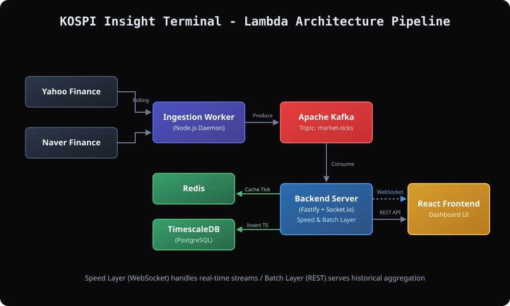

# KOSPI Insight Terminal 

국내외 거시 경제, 환율, 그리고 핵심 섹터 모멘텀을 실시간으로 추적하여 자금의 흐름을 한눈에 파악할 수 있는 프리미엄 인터랙티브 금융 대시보드입니다.



---

## 프로젝트 개요 (Overview)
기존의 정적인 금융 데이터 제공 방식에서 벗어나, **람다 아키텍처(Lambda Architecture)**를 적용하여 실시간 스트리밍(Speed Layer)과 대규모 과거 시계열 데이터(Batch Layer)를 완벽하게 분리, 통합 렌더링하는 풀스택 모니터링 시스템입니다.
Linear, Vercel 스타일의 다크 모드 기반 프리미엄 UI/UX 디자인을 제공합니다.

## 기술 스택 (Tech Stack)

### Frontend (Dashboard)
- **Framework**: React 18 (TypeScript), Vite
- **Styling**: Tailwind CSS, CSS Modules
- **Animation/Chart**: Framer Motion, Recharts
- **State/Real-time**: Socket.IO-client, React Hooks

### Backend (Data Pipeline & API)
- **Server**: Node.js, Fastify
- **Real-time**: Socket.IO
- **Data Ingestion**: `yahoo-finance2`, `axios` (Naver unofficial API)
- **Message Queue**: Apache Kafka (`kafkajs`), Zookeeper
- **Database / Cache**: TimescaleDB (PostgreSQL), Redis
- **Infra**: Docker, Docker Compose

---

## 아키텍처 및 파이프라인 (Architecture)

본 시스템은 지연을 최소화하고 확장성을 확보하기 위해 다음과 같은 파이프라인으로 동작합니다.

1. **데이터 수집 (Ingestion Worker)**
   - `yahoo-api.ts` 및 `naver-api.ts` 데몬이 10초 주기로 전 세계 시장 데이터를 폴링합니다.
   - 받아온 데이터를 통일된 포맷(`NormalizedMarketData`)으로 정제하여 Kafka에 발행(Produce)합니다.
2. **실시간 스트리밍 (Speed Layer)**
   - Fastify 백엔드가 Kafka Topic(`market-ticks`)을 즉시 소비(Consume)합니다.
   - Redis에 최신 상태를 캐싱한 뒤, 클라이언트와 연결된 WebSocket(Socket.IO)을 통해 차트에 틱 데이터를 브로드캐스팅합니다.
3. **과거 시계열 조회 (Batch Layer)**
   - Kafka에서 파생된 데이터가 지속적으로 TimescaleDB에 적재됩니다.
   - 프론트엔드에서 특정 기간(1주일, 1개월 등) 조회 요청 시, `Continuous Aggregates` 기능으로 자동 리샘플링된 데이터를 REST API로 응답합니다.

---

## 디렉토리 구조 (Directory Structure)

```text
kospi/
├── frontend/                 # React UI 클라이언트 영역
│   ├── src/
│   │   ├── components/       # ChartCard, DashboardGrid 등 메인 컴포넌트
│   │   ├── hooks/            # useMarketData (Socket, REST 통합 훅)
│   │   ├── constants/        # 카테고리 구성 데이터
│   │   └── ...
│   └── package.json
├── backend/                  # Fastify 서버 및 파이프라인 영역
│   ├── src/
│   │   ├── domains/          # history, market 컨트롤러 및 게이트웨이
│   │   ├── infrastructure/   # Redis, Kafka 연결 및 수집 데몬(ingestion)
│   │   └── shared/           # 공통 타입
│   └── package.json
├── docs/                     # 설계 문서 및 다이어그램
└── docker-compose.yml        # Kafka, Redis, DB 인프라 세팅 파일
```

---

## 실행 가이드라인 (Getting Started)

프로젝트를 로컬 환경에서 구동하기 위한 방법입니다.

### 1. 필수 조건 (Prerequisites)
- [Node.js](https://nodejs.org/en/) (v18 이상 권장)
- [Docker & Docker Compose](https://www.docker.com/) 설치 및 실행 중

### 2. 구동 순서

**Step 1: 인프라 컨테이너 실행**
프로젝트 루트 폴더에서 Kafka, Redis, TimescaleDB를 백그라운드 환경으로 실행합니다.
```bash
docker-compose up -d
```

**Step 2: 백엔드 API 서버 실행**
새로운 터미널을 열고 백엔드 의존성을 설치한 후 서버를 구동합니다.
```bash
cd backend
npm install
npm run dev
```

**Step 3: 데이터 수집 데몬(Worker) 실행**
새로운 터미널을 열고 백엔드 폴더에서 인제스천 워커를 단독으로 구동시킵니다.
```bash
cd backend
npm run ingestion
```

**Step 4: 프론트엔드 대시보드 실행**
새로운 터미널을 열고 프론트엔드 의존성을 설치한 후 클라이언트를 띄웁니다.
```bash
cd frontend
npm install
npm run dev
```

브라우저에서 `http://localhost:5173` 으로 접속하시면 실시간으로 작동하는 프리미엄 대시보드를 확인할 수 있습니다.

---

## 🙏 Acknowledgments (Credits)

본 프로젝트의 프론트엔드 UI/UX 설계 및 디자인 프롬프트 양식은 [Design Prompts (https://www.designprompts.dev/)](https://www.designprompts.dev/) 의 가이드라인을 영감받아 작성 및 적용되었습니다. 훌륭한 디자인 리소스를 제공해 주셔서 감사합니다.
